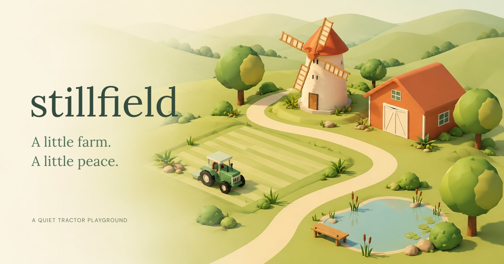

<p align="center">
  
</p>

# Stillfield

**A little farm. A little peace.**

Stillfield is a quiet tractor playground for iPhone, iPad, and the web. Drive slow rows through a soft green meadow, sow wheat, sunflowers, or pumpkins, and watch them grow. Then gather the harvest into flower pots and wooden carts beside the barn.

There's no currency, no deadlines, no energy meter, no quests, and no punishment for stepping away. The farm just waits, and nothing changes while you're gone.

### [Play in your browser at stillfield.io →](https://stillfield.io)

## What makes it feel like this

- 🚜 **Unhurried driving.** The tractor cruises at a gentle 3 m/s. Tap where you want it to work and it takes its time, turning in slow, wide arcs.
- 🌻 **Three crops, one calm loop.** Plow, sow, harvest. Sunflowers take 3 minutes, wheat 6, and pumpkins 9 of active play. Mature crops wait for you indefinitely.
- 🌾 **A harvest you can see.** Sunflower pots, golden wheat sheaves in a wheelbarrow, and pumpkins in a wooden cart fill in beside the barn path.
- 🎧 **Sound that's made on the spot.** Wind, birdsong, and a soft tractor hum are synthesized live, with no audio files.
- 📴 **Fully offline.** Play from the very first launch with no account, no cloud sync, no ads, and no tracking. Your meadow saves on your device.
- 🪟 **Two ways to view it.** Switch between a calm overhead view and a perspective view that follows behind the tractor, in the app or the browser.

## Run it yourself

**In the browser**

```sh
npm install
npm run dev
```

Vite prints a local URL and a network URL. Open the network URL in Safari on an iPad on the same Wi-Fi to try the touch controls. On a keyboard, use the arrow keys or WASD, 1–5 to switch tools, V for tractor view, and Space to pause.

**On iPhone or iPad**

```sh
open ios/Stillfield.xcodeproj
```

Pick the **Stillfield** scheme and a simulator, then press Run. It needs Xcode and iOS/iPadOS 18 or later. The native app has no external Swift package dependencies. To run on a real device, choose your own development team under **Signing & Capabilities** and a bundle identifier that's available to you.

## Under the hood

| | |
|---|---|
| **Web** | TypeScript, Three.js, Vite, and Web Audio. It's a PWA that installs to the home screen and works offline. |
| **Native** | SwiftUI for the interface, RealityKit for the 3D meadow, and AVAudioEngine for synthesized sound. |
| **Shared engine** | One deterministic farming loop, implemented in both TypeScript and Swift, on a 90 × 50 grid of 50 cm cells. |
| **Tests** | Engine, navigation, and camera tests in both languages, plus native UI tests that drive the real touch controls. |

More detail is in the docs:

- [How to play](docs/PLAY.md): every control and the full farming loop.
- [Development guide](docs/DEVELOPMENT.md): the native app, the farming engine, saves and migration, icons and artwork, and deployment.

## Contributing

Pull requests are very welcome. Bug fixes, tests, accessibility improvements, platform polish, and small quality-of-life ideas are all great. Please read [CONTRIBUTING.md](CONTRIBUTING.md) first, and note the [code of conduct](CODE_OF_CONDUCT.md). Stillfield has a deliberate point of view: it's calm, with no pressure mechanics, so new features should fit that feeling.

Found a bug or have an idea? [Open an issue](https://github.com/Karajelly/stillfield/issues). To report a security problem, see [SECURITY.md](SECURITY.md).

## License

The code is released under the [MIT License](LICENSE). The Stillfield name, icons, and artwork are not covered by it and remain all rights reserved; see [BRANDING.md](BRANDING.md) for the list and for what that means if you fork the project.
